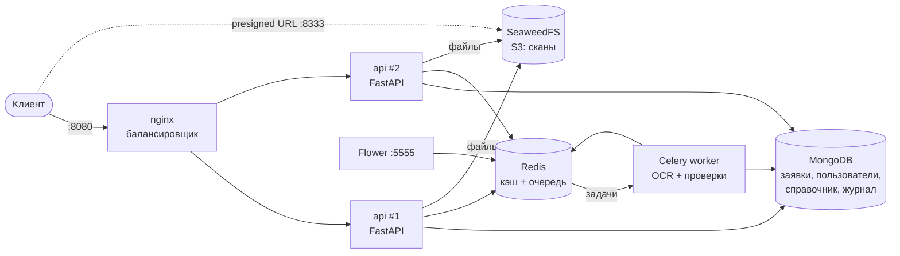
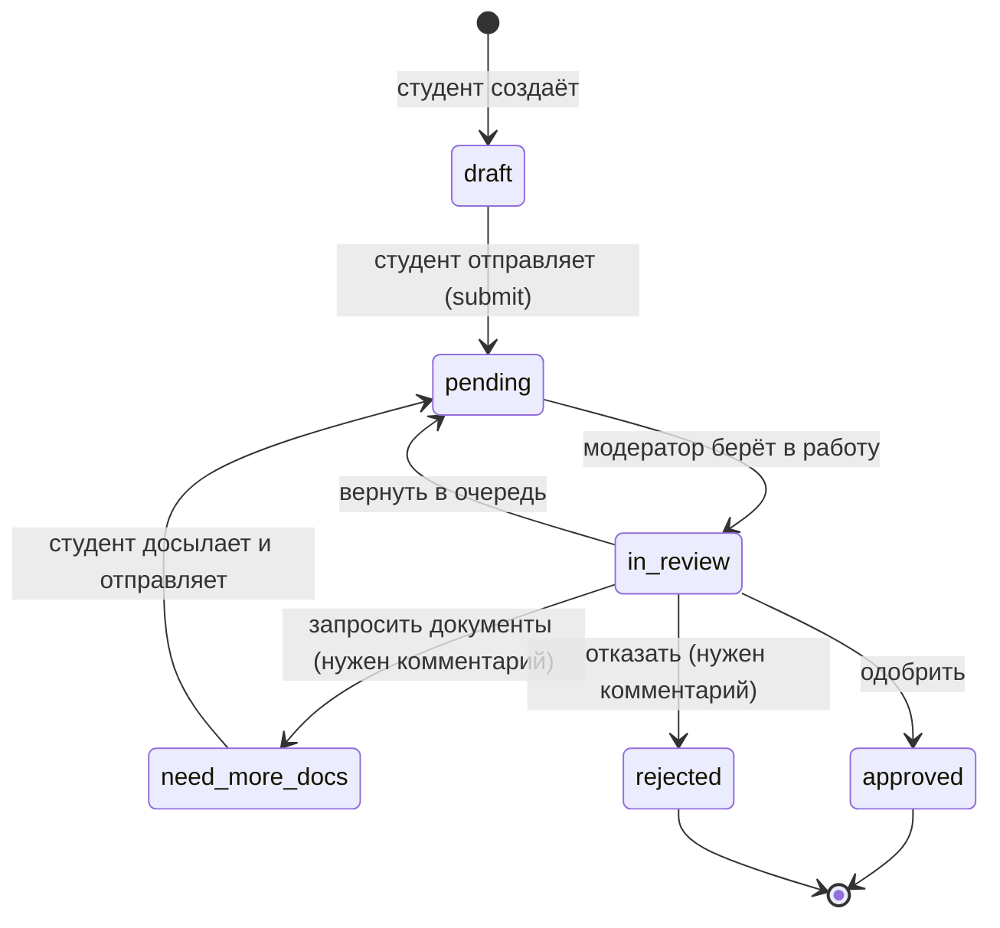

# СППО: API заявок на материальную поддержку

Прототип бэкенда для приёма и проверки заявлений студентов РУТ (МИИТ) на материальную поддержку.
Студент заполняет заявку и прикладывает сканы, фоновый воркер проверяет реквизиты и комплект документов,
модератор принимает решение, администратор управляет пользователями и справочником оснований.

Реализация опирается на два документа проекта, которые ведутся отдельно и в этот репозиторий не входят:
проектирование схемы MongoDB (`schema_zayavok_sppo.md`, ссылки вида «раздел N схемы» — на него)
и расчёт числа воркеров по модели M/M/c/K (`PD.ipynb`).

**Стек:** Python 3.13 · FastAPI · MongoDB 8 · Redis 7 · Celery 5 · SeaweedFS (S3) · nginx · Docker Compose

---

## Содержание

1. [Быстрый старт](#быстрый-старт)
2. [Архитектура](#архитектура)
3. [Роли и доступ](#роли-и-доступ)
4. [API](#api)
5. [Жизненный цикл заявки](#жизненный-цикл-заявки)
6. [Кэширование](#кэширование)
7. [Очередь и фоновая обработка](#очередь-и-фоновая-обработка)
8. [Хранение сканов](#хранение-сканов)
9. [Документация API](#документация-api)
10. [Безопасность](#безопасность)
11. [Структура репозитория](#структура-репозитория)
12. [Тесты](#тесты)
13. [Полезные команды](#полезные-команды)
14. [Если что-то не работает](#если-что-то-не-работает)
15. [Ограничения прототипа](#ограничения-прототипа)

---

## Быстрый старт

**Нужно:** [Docker Desktop](https://www.docker.com/products/docker-desktop/) (на Windows — с WSL 2) и Git.
Python на компьютере не обязателен.

```bash
git clone <url-репозитория>
cd backend
cp .env.example .env          # Windows PowerShell: Copy-Item .env.example .env
docker compose up -d --build
```

Первый запуск занимает несколько минут (скачиваются образы, собирается образ API).
Проверить, что всё поднялось:

```bash
docker compose ps
```

Сервисы `nginx`, `api` (2 реплики), `worker`, `mongo`, `redis`, `s3`, `flower` — в состоянии `running`/`healthy`,
`init` — `exited (0)`: он один раз готовит базу и завершается.

| Что | Адрес |
|---|---|
| Документация API (ReDoc) | http://localhost:8080/redoc |
| OpenAPI-схема | http://localhost:8080/openapi.json |
| Проверка готовности | http://localhost:8080/ready |
| Flower — мониторинг Celery | http://localhost:5555 (логин/пароль из `.env`: `FLOWER_USER` / `FLOWER_PASSWORD`) |

Администратор создаётся автоматически из `ADMIN_EMAIL` / `ADMIN_PASSWORD` в `.env`
(по умолчанию `admin@example.com` / `changeMeAdmin123`).

### Проверка одной командой

Сквозной сценарий от регистрации студента до одобрения заявки (нужен Python 3.10+, без библиотек):

```bash
python scripts/smoke_test.py
```

Скрипт проверяет балансировку, кэш справочника, регистрацию, создание заявки, загрузку файлов,
обработку в Celery, работу модератора и журнал аудита. В конце пишет `Всё работает.`

### Ручной сценарий через curl

Примеры для bash (на Windows — Git Bash). Токен из `/auth/login` передаётся в заголовке
`Authorization: Bearer <token>`.

```bash
API=http://localhost:8080/api/v1

# 1. Регистрация и вход студента
curl -s -X POST $API/auth/register -H "Content-Type: application/json" \
  -d '{"email":"student@example.com","password":"student-pass-123","full_name":"Ivanov Ivan"}'
TOKEN=$(curl -s -X POST $API/auth/login -d "username=student@example.com&password=student-pass-123" \
  | sed -E 's/.*"access_token":"([^"]+)".*/\1/')

# 2. Основания и нужные документы
curl -s $API/benefit-types

# 3. Заявка (тело — в файле application.json, пример ниже)
APP=$(curl -s -X POST $API/applications -H "Authorization: Bearer $TOKEN" \
  -H "Content-Type: application/json" -d @application.json | sed -E 's/^\{"id":"([^"]+)".*/\1/')

# 4. Скан документа (PDF, JPEG или PNG)
curl -s -X POST $API/applications/$APP/attachments -H "Authorization: Bearer $TOKEN" \
  -F type=passport_registration -F file=@passport.pdf

# 5. Отправка (ответ 202, проверка идёт в фоне), статус и результаты проверок
curl -s -X POST $API/applications/$APP/submit -H "Authorization: Bearer $TOKEN"
curl -s $API/applications/$APP/status -H "Authorization: Bearer $TOKEN"
curl -s $API/applications/$APP/checks -H "Authorization: Bearer $TOKEN"
```

Дальше — под админом `POST /admin/users` с `"role": "moderator"`, затем под модератором
`GET /moderation/queue` → `POST /applications/{id}/transitions` с `{"to": "in_review"}` →
`PATCH /applications/{id}/checks/{code}` → `{"to": "approved"}`. Весь этот путь автоматически
проходит `scripts/smoke_test.py`.

<details>
<summary>Пример application.json для POST /api/v1/applications</summary>

```json
{
  "basis": "orphan",
  "student": {
    "full_name": "Иванов Иван Иванович",
    "full_name_as_written": "Иванова Ивана Ивановича",
    "birth_date": "2005-03-14",
    "institute": "ИУЦТ",
    "group": "ТКИ-211",
    "course": 3,
    "inn": "500100732259",
    "passport": { "series": "4510", "number": "123456" }
  },
  "payout": { "bank": "ПАО Сбербанк", "bik": "044525225", "account_number": "40817810000000000001" },
  "form": { "applicant_signed": true, "consent_pd_signed": true }
}
```

Номер счёта в примере не проходит контрольный ключ — проверка `bank_account_checksum` покажет `mismatch`.
Так и задумано: видно, как работает автопроверка.
</details>

---

## Архитектура



| Сервис | Образ | Роль | Порт наружу |
|---|---|---|---|
| `nginx` | nginx:1.28 | Единая точка входа, балансировка между репликами `api`, rate limit | `8080` |
| `api` × 2 | свой (`api/Dockerfile`) | REST API на FastAPI | — |
| `worker` | свой | Celery: OCR-заглушка и автопроверки | — |
| `init` | свой | Однократно: валидаторы, индексы, справочник, первый админ, бакет | — |
| `flower` | свой | Веб-мониторинг очереди Celery | `127.0.0.1:5555` |
| `mongo` | mongo:8.0 | Документная БД | — |
| `redis` | redis:7.4 | Кэш (db 0), брокер Celery (db 1), результаты задач (db 2) | — |
| `s3` | seaweedfs:4.47 | S3-совместимое хранилище сканов | `127.0.0.1:8333` |

MongoDB и Redis наружу не открыты: к ним обращаются только сервисы внутри сети compose.

**Почему так.**

- **MongoDB.** Заявка — самодостаточный документ: данные, вложения, проверки и история читаются одним запросом.
  У справок разные поля. Новое основание добавляется в справочник без миграции
  (подробно — в `schema_zayavok_sppo.md`, раздел 1).
- **Celery.** Проверка заявки (в проде — OCR) идёт десятки секунд, держать HTTP-запрос столько нельзя.
  API отвечает `202 Accepted` сразу, воркер обрабатывает заявку в фоне.
- **Redis** — и кэш, и брокер Celery. Это проще, чем отдельный RabbitMQ, и для прототипа достаточно.
  Брокер меняется одной переменной `CELERY_BROKER` (см. `.env.example`).
- **nginx перед двумя репликами API** показывает горизонтальное масштабирование.
  Заголовок ответа `X-Instance` говорит, какая реплика ответила.

---

## Роли и доступ

| Роль | Как появляется | Что может |
|---|---|---|
| `student` | Сам регистрируется: `POST /auth/register` | Создавать, править и отправлять **свои** заявки, загружать сканы, видеть свой статус и проверки |
| `moderator` | Создаёт админ: `POST /admin/users` | Очередь заявок, просмотр любых заявок и сканов, ручные проверки, смена статуса |
| `admin` | Первый — из `.env` при запуске; остальных создаёт админ | Всё, что модератор, плюс пользователи и роли, справочник оснований, журнал аудита, статистика |

- **Авторизация — JWT.** Access-токен живёт 30 минут, refresh-токен — 7 дней. Роль и блокировка
  **проверяются по БД на каждом запросе**, поэтому смена роли или блокировка действуют сразу, без ожидания истечения токена.
- **Чужие заявки.** Студент, запросивший чужую заявку, получает `404`, а не `403`: так нельзя узнать,
  существует ли заявка с таким id.
- **Нельзя остаться без админа.** Админ не может понизить или заблокировать себя, и в системе всегда остаётся
  хотя бы один активный админ.
- **Журнал аудита.** Действия модераторов и админов пишутся в `audit_events`: смена статуса, ручные проверки,
  выдача ссылки на скан, изменения пользователей и справочника.

---

## API

Базовый путь — `/api/v1`. Все ошибки возвращаются в формате
[`application/problem+json`](https://www.rfc-editor.org/rfc/rfc9457):

```json
{ "type": "about:blank", "title": "Conflict", "status": 409,
  "detail": "Переход pending -> approved недопустим", "instance": "/api/v1/applications/.../transitions",
  "allowed": ["in_review"] }
```

### Авторизация

| Метод | Путь | Кто | Описание |
|---|---|---|---|
| POST | `/auth/register` | все | Регистрация студента |
| POST | `/auth/login` | все | Вход (OAuth2 form: `username` = email, `password`) → access + refresh |
| POST | `/auth/refresh` | все | Новая пара токенов по refresh-токену |
| GET | `/auth/me` | вошедший | Текущий пользователь |

### Справочник оснований (кэшируется)

| Метод | Путь | Кто | Описание |
|---|---|---|---|
| GET | `/benefit-types` | все, без входа | 13 оснований и обязательные документы |
| GET | `/benefit-types/{code}` | все, без входа | Одно основание |

### Заявки

| Метод | Путь | Кто | Описание |
|---|---|---|---|
| POST | `/applications` | student | Создать черновик. Заголовок `Idempotency-Key` защищает от дублей при повторной отправке |
| GET | `/applications` | вошедший | Список: студенту — свои, сотрудникам — все. Фильтры `status`, `basis`, `period`, пагинация `limit`/`offset` |
| GET | `/applications/{id}` | владелец, сотрудник | Заявка целиком |
| PATCH | `/applications/{id}` | владелец | Изменить (только `draft` или `need_more_docs`) |
| DELETE | `/applications/{id}` | владелец | Удалить черновик вместе со сканами |
| POST | `/applications/{id}/submit` | владелец | Отправить на проверку → `202` и `task_id`. `503`, если очередь переполнена |
| GET | `/applications/{id}/status` | владелец, сотрудник | Статус и состояние обработки (кэш Redis) |
| GET | `/applications/{id}/history` | владелец, сотрудник | История статусов с комментариями |
| GET | `/applications/{id}/checks` | владелец, сотрудник | Результаты проверок |

### Вложения

| Метод | Путь | Кто | Описание |
|---|---|---|---|
| POST | `/applications/{id}/attachments` | владелец | multipart: `file` + `type`. PDF/JPEG/PNG до 10 МБ, тип определяется по содержимому |
| GET | `/applications/{id}/attachments` | владелец, сотрудник | Список вложений |
| GET | `/applications/{id}/attachments/{aid}/download-url` | владелец, сотрудник | Временная ссылка на скачивание (10 минут) |
| DELETE | `/applications/{id}/attachments/{aid}` | владелец | Удалить вложение |

### Модерация

| Метод | Путь | Кто | Описание |
|---|---|---|---|
| GET | `/moderation/queue` | moderator, admin | Очередь FIFO: `status=pending` или `in_review` |
| POST | `/applications/{id}/transitions` | moderator, admin | Сменить статус: `{"to": "...", "comment": "..."}` |
| PATCH | `/applications/{id}/checks/{code}` | moderator, admin | Ручное решение: `manual_ok` / `manual_rejected` |

### Администрирование

| Метод | Путь | Описание |
|---|---|---|
| GET / POST | `/admin/users` | Список (фильтры `role`, `is_active`, `q`), создание пользователя с любой ролью |
| GET / PATCH | `/admin/users/{id}` | Просмотр; смена роли, блокировка, переименование |
| POST | `/admin/benefit-types` | Новое основание |
| PUT / DELETE | `/admin/benefit-types/{code}` | Изменить; отключить (мягкое удаление — старые заявки на него ссылаются) |
| GET | `/admin/audit-events` | Журнал действий сотрудников |
| GET | `/admin/stats` | Заявки по статусам и основаниям, пользователи по ролям, длина очереди |

### Служебные

| Метод | Путь | Описание |
|---|---|---|
| GET | `/health` | Процесс жив (liveness) |
| GET | `/ready` | Доступны MongoDB, Redis и S3 (readiness), иначе `503` |
| GET | `/api/v1/tasks/{task_id}` | Состояние задачи Celery |

---

## Жизненный цикл заявки



**Правила.**

- Студент меняет данные и вложения только в `draft` и `need_more_docs`.
- В работу (`in_review`) нельзя взять заявку, пока воркер её обрабатывает.
- Одобрить можно, только если автопроверки завершены и ни одна проверка не в статусе `needs_review`,
  `mismatch` или `manual_rejected`. Иначе API возвращает `409` со списком `blocking_checks`.
- Решение всегда за человеком: автоматических отказов нет.
- Одна активная заявка на студента по одному основанию в одном периоде (`period`, например `2026-autumn`).

**Проверки** (`checks[]`):

| Код | Тип | Что проверяет |
|---|---|---|
| `required_docs_complete` | авто | Комплект документов по справочнику, с учётом вариантов «ИЛИ» |
| `inn_checksum` | авто | Контрольные цифры ИНН |
| `passport_format` | авто | Серия — 4 цифры, номер — 6 цифр |
| `bank_account_checksum` | авто | Контрольный ключ счёта по БИК |
| `fio_nominative_vs_written` | авто | ФИО в именительном падеже ↔ в родительном (как в заявлении): pymorphy3 + rapidfuzz, пороги 90/70 |
| `fio_form_vs_passport` | авто | Сверка со сканом паспорта. OCR — заглушка, поэтому всегда `needs_review` |
| `duplicate_files` | авто | Тот же файл (sha256) в заявке другого студента |
| `duplicate_payout` | авто | Тот же счёт у другого студента в том же периоде |
| `union_card_extended`, `applicant_signature` | ручная | Профбилет продлён, подпись на заявлении |
| `dorm_head_signed`, `doctor_certified` | ручная | Только для оснований «общежитие» и «диспансерный учёт» |

---

## Кэширование

Справочник оснований меняется редко, а читается при каждой заявке. Он кэшируется на трёх уровнях:

| Уровень | Как | Как увидеть |
|---|---|---|
| Redis на сервере | Cache-aside: при промахе — MongoDB, результат в Redis на 1 час | Заголовок `X-Cache: MISS` при первом запросе, потом `HIT` |
| HTTP ETag | Хеш содержимого; при `If-None-Match` с тем же значением — `304` без тела | `curl -i` с заголовком `If-None-Match` |
| Браузер | `Cache-Control: public, max-age=300` | DevTools → Network |

**Инвалидация.** Любое изменение справочника через `/admin/benefit-types` удаляет ключ в Redis,
следующий запрос берёт свежие данные из MongoDB. Сервис `init` тоже сбрасывает ключ после заполнения справочника.

**Статус заявки** (`GET /applications/{id}/status`) кэшируется на 5 секунд. Его опрашивают часто, пока
идёт обработка. Ключ удаляется при любой смене статуса — и в API, и в воркере, поэтому устаревших данных
клиент не увидит.

```bash
curl -s -o /dev/null -D - http://localhost:8080/api/v1/benefit-types | grep -i -E "x-cache|etag"
```

---

## Очередь и фоновая обработка

```
POST /submit → статус pending, processing.state = queued → задача в Redis (очередь "applications")
     → Celery worker: OCR-заглушка по каждому файлу → проверки → поиск дублей
     → checks[] в документ, processing.state = done → заявка в очереди модератора
```

- **Надёжность.** `acks_late`: если воркер упал посреди задачи, задача вернётся в очередь.
  `prefetch_multiplier = 1`: воркер не забирает лишних длинных задач. При ошибке — до 3 повторов.
- **Связь с моделью M/M/c/K (`PD.ipynb`).**
  - c — число параллельных обработчиков: `CELERY_CONCURRENCY` × число контейнеров `worker`.
    Для пика 500 заявок/ч при 75 с на заявку модель даёт минимум 11.
  - K — ёмкость очереди: `MAX_QUEUE_LENGTH`. При переполнении `POST /submit` отвечает
    `503 Service Unavailable` с `Retry-After`, как в модели — отказ при заполненной системе.
- **Масштабирование:**

```bash
docker compose up -d --scale worker=3     # больше воркеров
docker compose up -d --scale api=4        # больше реплик API; nginx подхватит их сам
```

Очередь видно во Flower (http://localhost:5555) и в `GET /api/v1/admin/stats`.

---

## Хранение сканов

- Файлы лежат в S3-совместимом хранилище (SeaweedFS), в MongoDB — только `bucket`, `key`, `sha256` и метаданные
  (раздел 4 схемы).
- Ключ объекта — `applications/{application_id}/{uuid}.{ext}`, без ФИО и других персональных данных.
- Бакет закрыт, анонимного доступа нет. Скачать файл можно только по presigned URL, который API выдаёт
  после проверки прав. Ссылка живёт 10 минут. Выдача ссылки сотруднику пишется в журнал аудита.
- Данные на диске SeaweedFS шифруются (`-s3.encryptVolumeData=true`).
- Тип файла определяется по сигнатуре (magic bytes), а не по расширению или заголовку от клиента:
  исполняемый файл с расширением `.png` будет отклонён с `415`.

> **Почему не MinIO.** В 2025 году MinIO перестал публиковать образы community-версии на Docker Hub.
> SeaweedFS — открытый (Apache 2.0) аналог с тем же S3 API. Код работает через boto3 и от конкретного
> хранилища не зависит: можно подставить любое S3, поменяв `S3_ENDPOINT` и ключи.

---

## Документация API

FastAPI строит OpenAPI-схему из кода автоматически, поэтому документация не расходится с реализацией:

- http://localhost:8080/redoc — документация для чтения;
- http://localhost:8080/openapi.json — схема в формате OpenAPI 3.1;
- `docs/openapi.yaml` — та же схема в репозитории, обновляется командой
  `python scripts/export_openapi.py` (нужны зависимости из `api/requirements-dev.txt`).

Схему можно импортировать в Postman, Insomnia или генератор клиентов (openapi-generator).

---

## Безопасность

**Сделано:**

- **Секреты.** Только в `.env`, который в `.gitignore`. В репозитории — `.env.example`.
  Без обязательных переменных compose не запустится и скажет, какой не хватает.
- **Пароли.** Хешируются argon2. Вход с несуществующим email занимает столько же времени,
  что и с существующим, чтобы по таймингу нельзя было подбирать email.
- **JWT.** Секрет не короче 32 символов (иначе приложение не стартует). Отдельные типы токенов — access и refresh.
- **Права.** RBAC на каждом эндпоинте, роль и блокировка берутся из БД.
- **Доступ к БД и хранилищу.**
  - Приложение ходит в MongoDB не под root, а под отдельным пользователем с правами только на свою базу
    (`mongo/init/01-create-app-user.js`).
  - MongoDB и Redis наружу не опубликованы. Redis — с паролем.
  - S3 и Flower доступны только с `127.0.0.1`.
- **nginx.** Rate limit: на `/auth/login` и `/auth/register` — 10 запросов в минуту с IP (защита от перебора паролей),
  на остальное — 20 в секунду. Заголовки `X-Content-Type-Options`, `X-Frame-Options`, `Referrer-Policy`.
  Версия nginx скрыта.
- **Ошибки валидации.** Не возвращают введённые значения: пароль или паспорт не попадут в ответ и в логи клиента.
- **Контейнеры.** Работают не от root.
- **Аудит.** Журнал действий сотрудников с персональными данными.

**Для продакшена ещё нужно (152-ФЗ, раздел 7 схемы):**

- HTTPS: TLS-сертификат в nginx.
- Шифрование чувствительных полей в MongoDB (паспорт, ИНН, адрес, счёт): CSFLE или шифрование в приложении.
- Сервер в РФ, сроки хранения и удаление сканов, регламент доступа.
- Вход через SSO вуза вместо собственной регистрации.
- Отзыв refresh-токенов (список отозванных `jti` в Redis), блокировка после N неудачных входов.

---

## Структура репозитория

```
backend/
├── docker-compose.yml          # весь стек
├── .env.example                # шаблон настроек (скопировать в .env)
├── .gitignore / .gitattributes
├── nginx/
│   ├── nginx.conf              # балансировщик, rate limit, заголовки
│   └── proxy_params.conf
├── mongo/init/
│   └── 01-create-app-user.js   # пользователь БД для приложения
├── docs/
│   └── openapi.yaml            # OpenAPI-схема API
├── scripts/
│   ├── smoke_test.py           # сквозная проверка запущенного стека
│   └── export_openapi.py       # выгрузка docs/openapi.yaml
└── api/                        # один образ для api, worker, init, flower
    ├── Dockerfile
    ├── requirements.txt / requirements-dev.txt
    ├── app/
    │   ├── main.py             # FastAPI: роутеры, middleware, OpenAPI
    │   ├── config.py           # настройки из переменных окружения
    │   ├── domain.py           # роли, статусы, переходы, типы документов
    │   ├── schemas.py          # Pydantic-модели запросов и ответов
    │   ├── seed.py             # 13 оснований из бланков СППО
    │   ├── bootstrap.py        # init: валидаторы $jsonSchema, индексы, сид, админ, бакет
    │   ├── db.py / cache.py / storage.py   # MongoDB / Redis / S3
    │   ├── security.py / deps.py           # argon2, JWT, проверка ролей
    │   ├── errors.py / audit.py / serializers.py
    │   ├── routers/            # auth, benefit_types, applications, attachments, moderation, admin, system
    │   ├── services/           # проверки: ИНН, счёт, ФИО; логика заявок; справочник с кэшем
    │   └── worker/             # Celery: приложение и задачи
    └── tests/                  # pytest: проверки, ФИО, переходы статусов, API
```

---

## Тесты

Юнит-тесты не требуют запущенных MongoDB и Redis:

```bash
docker build --target test -t sppo-api-test ./api
docker run --rm sppo-api-test
```

Без Docker (Python 3.13):

```bash
cd api
python -m venv .venv
.venv/bin/pip install -r requirements-dev.txt    # Windows: .venv\Scripts\pip
.venv/bin/python -m pytest -q
```

Что покрыто:

- контрольные суммы ИНН и счёта;
- сверка ФИО в разных падежах, включая женские фамилии и «ё»;
- полнота комплекта документов с вариантами «ИЛИ»;
- слияние ручных и автоматических проверок;
- матрица переходов статусов по ролям;
- определение типа файла по сигнатуре;
- маршруты, 401 без токена, формат ошибок.

Сквозной сценарий на запущенном стеке — `python scripts/smoke_test.py`.

---

## Полезные команды

```bash
docker compose ps                         # состояние сервисов
docker compose logs -f api worker         # логи
docker compose logs init                  # что сделала инициализация
docker compose restart api                # перезапуск
docker compose up -d --build api worker   # пересобрать после изменения кода
docker compose down                       # остановить (данные сохранятся в томах)
docker compose down -v                    # остановить и УДАЛИТЬ все данные
docker compose exec mongo mongosh -u root -p   # консоль MongoDB (пароль — MONGO_ROOT_PASSWORD)
```

Проверить балансировку — значения `X-Instance` будут чередоваться:

```bash
for i in 1 2 3 4; do curl -s -D - -o /dev/null http://localhost:8080/health | grep -i x-instance; done
```

---

## Если что-то не работает

| Симптом | Причина и решение |
|---|---|
| `required variable ... is missing` | Нет файла `.env` — скопируйте `.env.example` в `.env` |
| `port is already allocated` | Порт 8080 занят — поменяйте `HTTP_PORT` в `.env` |
| `init` завершился с ошибкой, `Authentication failed` | Пароль MongoDB в `.env` поменяли после первого запуска. Пользователь создаётся только на пустом томе: `docker compose down -v` и снова `up` |
| `mongo` сразу падает, в логе про AVX | MongoDB 5+ требует процессор с инструкциями AVX: на очень старых CPU и некоторых виртуалках не запустится |
| На Windows ошибки `\r` в скриптах контейнера | Git превратил LF в CRLF. В репозитории есть `.gitattributes`, которые это запрещают; если клонировали до его появления — склонируйте заново |
| `429 Too Many Requests` на `/auth/login` | Сработал rate limit (10 запросов в минуту) — подождите минуту |
| Presigned-ссылка не открывается | Ссылка подписана для `S3_PUBLIC_ENDPOINT` (`http://localhost:8333`). Открывайте её на той же машине или поменяйте адрес в `.env` |
| `/ready` отвечает `503` | Смотрите поле `checks` в ответе и `docker compose logs <сервис>` |

---

## Ограничения прототипа

- **OCR — заглушка.** Пауза `OCR_STUB_DELAY_SEC` секунд на файл, данные со сканов не извлекаются.
  Подключить PaddleOCR — заменить `_run_ocr_stub` в `app/worker/tasks.py` (образ вырастет на несколько ГБ).
- **Персональные поля не шифруются** (см. «Безопасность»). Используйте только тестовые данные.
- **Нет фронтенда:** работа через любой HTTP-клиент (curl, Postman).
- **Пагинация** через `limit`/`offset`. Для больших объёмов лучше курсорная, по `created_at` + `_id`.
- **Открытые вопросы к профкому** (раздел 8 схемы) влияют на правила: можно ли подавать по нескольким
  основаниям, сроки действия справок и т.п.
