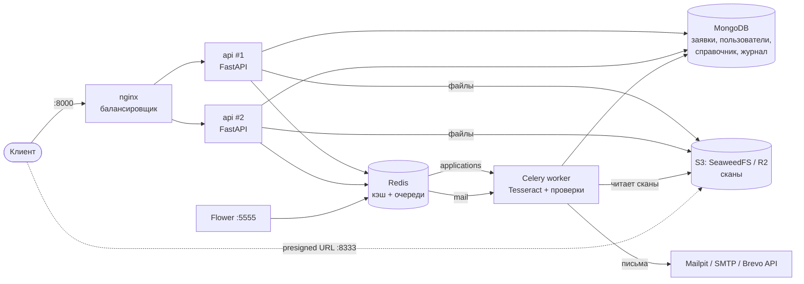
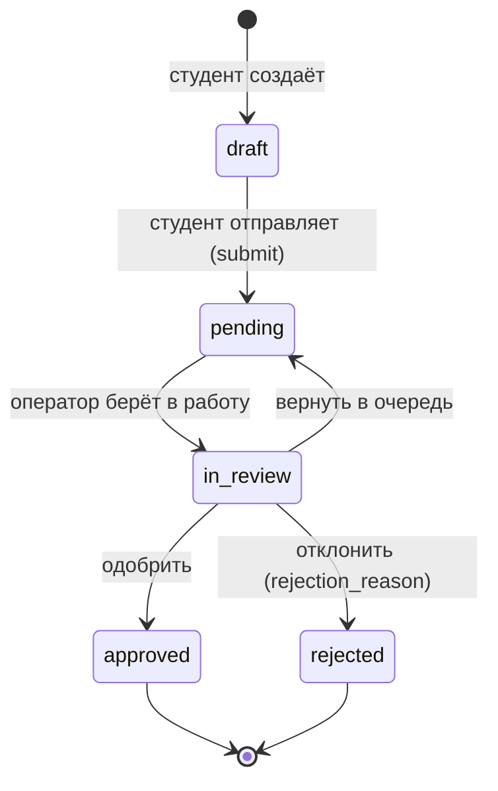

# СППО: API заявок на материальную поддержку

Бэкенд для приёма и проверки заявлений студентов РУТ (МИИТ) на материальную поддержку.
Студент заполняет электронную форму, прикладывает сканы и отправляет заявку. Фоновый воркер распознаёт сканы
(Tesseract) и сверяет их с формой, оператор профкома принимает решение, администратор управляет пользователями
и справочником оснований. О результате студент узнаёт из письма.

Реализация опирается на два документа проекта, которые ведутся отдельно и в этот репозиторий не входят:
проектирование схемы MongoDB (`schema_zayavok_sppo.md`, ссылки вида «раздел N схемы» — на него)
и расчёт числа воркеров по модели M/M/c/K (`PD.ipynb`).

**Стек:** Python 3.13 · FastAPI · MongoDB 8 (replica set) · Redis 7 · Celery 5 · Tesseract 5 + poppler ·
S3 (SeaweedFS / Cloudflare R2) · nginx · Docker Compose

---

## Содержание

1. [Быстрый старт](#быстрый-старт)
2. [Архитектура](#архитектура)
3. [Роли и доступ](#роли-и-доступ)
4. [API](#api)
5. [Жизненный цикл заявки](#жизненный-цикл-заявки)
6. [Распознавание сканов (OCR)](#распознавание-сканов-ocr)
7. [Почтовые уведомления](#почтовые-уведомления)
8. [Кэширование](#кэширование)
9. [Очередь, подметальщик и фоновая обработка](#очередь-подметальщик-и-фоновая-обработка)
10. [Приоритет оснований и очередь оператора](#приоритет-оснований-и-очередь-оператора)
11. [Журнал аудита](#журнал-аудита)
12. [Хэши паспорта и счёта](#хэши-паспорта-и-счёта)
13. [Транзакции и replica set](#транзакции-и-replica-set)
14. [Хранение сканов](#хранение-сканов)
15. [Документация API](#документация-api)
16. [Развёртывание в облаке](#развёртывание-в-облаке)
17. [Безопасность](#безопасность)
18. [Структура репозитория](#структура-репозитория)
19. [Тесты](#тесты)
20. [Полезные команды](#полезные-команды)
21. [Если что-то не работает](#если-что-то-не-работает)
22. [Ограничения](#ограничения)

---

## Быстрый старт

**Нужно:** [Docker Desktop](https://www.docker.com/products/docker-desktop/) (на Windows — с WSL 2) и Git.
Python на компьютере не обязателен.

```bash
git clone <url-репозитория>
cd backend
cp .env.example .env          # Windows PowerShell: Copy-Item .env.example .env
docker compose up -d --build
```

Первый запуск занимает несколько минут (скачиваются образы, в образ API ставится Tesseract).
Проверить, что всё поднялось:

```bash
docker compose ps
```

Сервисы `nginx`, `api` (2 реплики), `worker`, `mongo`, `redis`, `s3`, `mailpit`, `flower` — в состоянии
`running`/`healthy`, `init` — `exited (0)`: он один раз готовит базу и завершается.

| Что | Адрес |
|---|---|
| **API** (его адрес использует фронтенд: `http://localhost:8000/api/v1`) | http://localhost:8000 |
| Документация API (ReDoc) | http://localhost:8000/redoc |
| OpenAPI-схема | http://localhost:8000/openapi.json |
| Проверка готовности | http://localhost:8000/ready |
| **Mailpit — все письма, которые «отправила» система** | http://localhost:8025 |
| Flower — мониторинг Celery | http://localhost:5555 (логин и пароль из `.env`: `FLOWER_USER` / `FLOWER_PASSWORD`) |

Порт API меняется в `.env`: `HTTP_PORT`.

### Демо-учётные записи

При `SEED_DEMO_USERS=true` (так в `.env.example`) при старте создаются три учётки (`app/seed.py`):

| Роль | Email | Пароль |
|---|---|---|
| Студент | `student@rut.ru` | `student123` |
| Оператор комиссии | `operator@rut.ru` | `operator123` |
| Администратор | `admin@rut.ru` | `admin123` |

Пароли известны всем, поэтому **на сервере с реальными данными демо-учётки нужно отключить**
(`SEED_DEMO_USERS=false`). Создать или пересоздать их вручную: `docker compose exec api python -m app.seed`.
Отдельно из `ADMIN_EMAIL` / `ADMIN_PASSWORD` создаётся «боевой» администратор, если в базе нет ни одного.

### Проверка одной командой

Сквозной сценарий (нужен Python 3.10+, без библиотек):

```bash
python scripts/smoke_test.py
```

Скрипт проходит весь путь заявки на живом стеке: балансировка, кэш справочника, регистрация, загрузка учебных
сканов, распознавание Tesseract'ом в воркере, проверки по сканам, решение оператора, письма в Mailpit, очередь
оператора по приоритету, журнал аудита. Отдельно проверяет, что **студент не видит ничего про OCR**, а при сбое
распознавания оператор всё равно может открыть заявку, перезапустить OCR и отклонить заявку с причиной.
В конце пишет `Всё работает.`

```bash
python scripts/smoke_test.py --chaos
```

С флагом `--chaos` тест ещё **останавливает Redis (очередь)**, отправляет заявку от имени студента и проверяет,
что она принята (`202`, статус `pending`, без `503`), а после запуска Redis подметальщик сам ставит её на
распознавание. Нужен `docker compose` в PATH.

### Ручной сценарий через curl

Примеры для bash (на Windows — Git Bash). Токен из `/auth/login` передаётся в заголовке
`Authorization: Bearer <token>`.

```bash
API=http://localhost:8000/api/v1

# 1. Вход студента (демо-учётка) и основания с нужными документами
TOKEN=$(curl -s -X POST $API/auth/login -d "username=student@rut.ru&password=student123" \
  | sed -E 's/.*"access_token":"([^"]+)".*/\1/')
curl -s $API/benefit-types

# 2. Заявка (тело — в файле application.json, пример ниже)
APP=$(curl -s -X POST $API/applications -H "Authorization: Bearer $TOKEN" \
  -H "Content-Type: application/json" -d @application.json | sed -E 's/^\{"id":"([^"]+)".*/\1/')

# 3. Сканы (PDF, JPEG или PNG): для основания «сирота» нужно 5 документов, образцы лежат в scripts/fixtures
for pair in passport_registration:passport.png union_card:certificate.png \
            bank_requisites_screenshot:bank.png birth_certificate_student:certificate.png \
            death_certificate:certificate.png; do
  curl -s -X POST $API/applications/$APP/attachments -H "Authorization: Bearer $TOKEN" \
    -F type=${pair%%:*} -F file=@scripts/fixtures/${pair##*:}
done

# 4. Отправка: ответ 202. Если документов не хватает — 422 со списком недостающих слотов
curl -s -X POST $API/applications/$APP/submit -H "Authorization: Bearer $TOKEN"
curl -s $API/applications/$APP/status -H "Authorization: Bearer $TOKEN"
```

Письмо «заявка принята» появится в Mailpit (http://localhost:8025). Дальше — вход под `operator@rut.ru`:
`GET /operator/queue` → `POST /applications/{id}/transitions` с `{"to": "in_review"}` →
`PATCH /applications/{id}/checks/{code}` (ручные проверки) →
`POST /applications/{id}/transitions` с `{"to": "approved"}` или `{"to": "rejected", "rejection_reason": "..."}`.

<details>
<summary>Пример application.json для POST /api/v1/applications</summary>

```json
{
  "basis": "orphan",
  "student": {
    "full_name": "Иванов Иван Иванович",
    "birth_date": "2005-03-14",
    "institute": "ИУЦТ",
    "group": "ТКИ-211",
    "course": 3,
    "email": "student@rut.ru",
    "inn": "770708389324",
    "passport": { "series": "4510", "number": "123456" }
  },
  "payout": { "bank": "ПАО Сбербанк", "bik": "044525225", "account_number": "40817810700000000001" },
  "form": { "applicant_signed": true, "consent_pd_signed": true }
}
```

`student.email` обязателен: на него приходят уведомления о статусе заявки. Данные паспорта и реквизиты в примере
совпадают с учебными сканами из `scripts/fixtures`, поэтому проверки по сканам пройдут (`auto_ok`).
</details>

---

## Архитектура



| Сервис | Образ | Роль | Порт наружу |
|---|---|---|---|
| `nginx` | nginx:1.28 | Единая точка входа, балансировка между репликами `api`, rate limit | `8000` |
| `api` × 2 | свой (`api/Dockerfile`) | REST API на FastAPI | — |
| `worker` | свой (с Tesseract) | Celery: распознавание сканов, автопроверки, отправка писем | — |
| `init` | свой | Однократно: валидаторы, индексы, миграция данных (в том числе хэши и `audit_logs`), справочник, учётки, бакет | — |
| `flower` | свой | Веб-мониторинг очереди Celery | `127.0.0.1:5555` |
| `mailpit` | axllent/mailpit | Почтовая «песочница»: принимает письма и показывает их в браузере | `127.0.0.1:8025` |
| `mongo` | mongo:8.0 | Документная БД; replica set из одного узла `rs0` (транзакции), создаётся автоматически | — |
| `redis` | redis:7.4 | Кэш (db 0), брокер Celery (db 1), результаты задач (db 2) | — |
| `s3` | seaweedfs:4.47 | S3-совместимое хранилище сканов | `127.0.0.1:8333` |

MongoDB и Redis наружу не открыты: к ним обращаются только сервисы внутри сети compose.

**Почему так.**

- **MongoDB.** Заявка — самодостаточный документ: данные, вложения, проверки и история читаются одним запросом.
  У справок разные поля. Новое основание добавляется в справочник без миграции
  (подробно — в `schema_zayavok_sppo.md`, раздел 1).
- **Celery.** Распознавание сканов идёт десятки секунд, держать HTTP-запрос столько нельзя.
  API отвечает `202 Accepted` сразу, воркер обрабатывает заявку в фоне. Письма — тоже задачи Celery
  (отдельная очередь `mail`), а не HTTP-запросы из обработчика.
- **Redis** — и кэш, и брокер Celery. Это проще, чем отдельный RabbitMQ, и для альфа-версии достаточно.
  Брокер меняется одной переменной `CELERY_BROKER` (см. `.env.example`).
- **nginx перед двумя репликами API** показывает горизонтальное масштабирование.
  Заголовок ответа `X-Instance` говорит, какая реплика ответила.
- **Tesseract вместо PaddleOCR.** Меньше памяти (сотни МБ вместо гигабайт), ставится пакетом ОС, в образе — русский
  и английский языки. Это позволяет показать систему даже на бесплатных тарифах.

---

## Роли и доступ

| Роль | Как появляется | Что может |
|---|---|---|
| `student` | Сам регистрируется: `POST /auth/register` | Создавать, править и отправлять **свои** заявки, загружать сканы, видеть статус и причину отказа |
| `operator` | Создаёт админ: `POST /admin/users` | Очередь заявок, любые заявки и сканы, результаты распознавания и проверок, решение (одобрить / отклонить), перезапуск OCR |
| `admin` | Первый — из `.env` или демо-учётка; остальных создаёт админ | Всё, что оператор, плюс пользователи и роли, справочник оснований, журнал аудита, статистика |

- **Студент ничего не знает про OCR.** Его контракт заканчивается на «заполнил форму, приложил документы,
  нажал на отправку, когда кнопка разблокировалась». В ответах студенту нет полей `ocr`, `checks`, точности
  распознавания и результатов по вложениям; эндпоинты `/checks`, `/ocr/restart` и `/tasks` для него закрыты (`403`);
  в письмах распознавание не упоминается. Сбой OCR — внутренняя операционная проблема, студент видит всё те же
  «на рассмотрении».
- **Авторизация — JWT.** Access-токен живёт 30 минут, refresh-токен — 7 дней. Роль и блокировка
  **проверяются по БД на каждом запросе**, поэтому смена роли или блокировка действуют сразу.
- **Чужие заявки.** Студент, запросивший чужую заявку, получает `404`, а не `403`: так нельзя узнать,
  существует ли заявка с таким id.
- **Нельзя остаться без админа.** Админ не может понизить или заблокировать себя.
- **Журнал аудита.** События студентов, операторов, админов и системы пишутся в `audit_logs`
  (см. [Журнал аудита](#журнал-аудита)): смена статуса вместе с причиной отказа, ручные проверки, OCR, просмотр сканов,
  изменения пользователей и справочника.

---

## API

Базовый путь — `/api/v1`. Все ошибки возвращаются в формате
[`application/problem+json`](https://www.rfc-editor.org/rfc/rfc9457):

```json
{ "type": "about:blank", "title": "Conflict", "status": 409,
  "detail": "Переход pending -> approved недопустим", "instance": "/api/v1/applications/.../transitions",
  "allowed": ["in_review"] }
```

### Авторизация

| Метод | Путь | Кто | Описание |
|---|---|---|---|
| POST | `/auth/register` | все | Регистрация студента |
| POST | `/auth/login` | все | Вход (OAuth2 form: `username` = email, `password`) → access + refresh |
| POST | `/auth/refresh` | все | Новая пара токенов по refresh-токену |
| GET | `/auth/me` | вошедший | Текущий пользователь |

### Справочник оснований (кэшируется)

| Метод | Путь | Кто | Описание |
|---|---|---|---|
| GET | `/benefit-types` | все, без входа | 13 оснований и обязательные документы |
| GET | `/benefit-types/{code}` | все, без входа | Одно основание |

### Заявки

| Метод | Путь | Кто | Описание |
|---|---|---|---|
| POST | `/applications` | student | Создать черновик. `Idempotency-Key` защищает от дублей при повторной отправке |
| GET | `/applications` | вошедший | Список: студенту — свои, сотрудникам — все (+ `ocr_state`, `ocr_accuracy`). Фильтры `status`, `basis`, `period`, `limit`/`offset` |
| GET | `/applications/{id}` | владелец, сотрудник | Заявка целиком (сотруднику — с `checks` и `ocr`) |
| PATCH | `/applications/{id}` | владелец | Изменить (только в `draft`) |
| DELETE | `/applications/{id}` | владелец | Удалить черновик вместе со сканами |
| POST | `/applications/{id}/submit` | владелец | Отправить на рассмотрение → `202`. `422`, если нет согласия на обработку ПДн или не приложены обязательные документы (в ответе `missing_slots`). **От очереди и брокера не зависит**: `503` студент не получает, заявку в очередь поставит подметальщик |
| GET | `/applications/{id}/status` | владелец, сотрудник | Статус (и `rejection_reason`); сотруднику ещё и состояние OCR. Кэш Redis |
| GET | `/applications/{id}/history` | владелец, сотрудник | История статусов (студенту — без служебных заметок, только причина отказа) |
| GET | `/applications/{id}/checks` | **оператор, админ** | Результаты автоматических и ручных проверок |

### Вложения

| Метод | Путь | Кто | Описание |
|---|---|---|---|
| POST | `/applications/{id}/attachments` | владелец | multipart: `file` + `type`. PDF/JPEG/PNG до 10 МБ, тип определяется по содержимому |
| GET | `/applications/{id}/attachments` | владелец, сотрудник | Список вложений (сотруднику — с результатом распознавания) |
| GET | `/applications/{id}/attachments/{aid}/download-url` | владелец, сотрудник | Временная ссылка на скачивание (10 минут) |
| DELETE | `/applications/{id}/attachments/{aid}` | владелец | Удалить вложение |

### Оператор

| Метод | Путь | Кто | Описание |
|---|---|---|---|
| GET | `/operator/queue` | оператор, админ | Очередь: сначала меньший `priority` основания (выше приоритет), затем раньше поданные (`submitted_at`). `status=pending` или `in_review`; фильтр `ocr_state`. В каждой заявке `priority`, `ocr_state` (`ready_for_review`, `ocr_failed`…) и `ocr_accuracy` |
| POST | `/applications/{id}/transitions` | оператор, админ | Сменить статус: `{"to": "...", "rejection_reason": "...", "comment": "..."}`. Для `rejected` причина обязательна |
| PATCH | `/applications/{id}/checks/{code}` | оператор, админ | Ручное решение: `manual_ok` / `manual_rejected` |
| POST | `/applications/{id}/ocr/restart` | оператор, админ | Перезапустить распознавание (кнопка «Перезапустить OCR») → `202` |

### Администрирование

| Метод | Путь | Описание |
|---|---|---|
| GET / POST | `/admin/users` | Список (фильтры `role`, `is_active`, `q`), создание пользователя с любой ролью |
| GET / PATCH | `/admin/users/{id}` | Просмотр; смена роли, блокировка, переименование |
| POST | `/admin/benefit-types` | Новое основание |
| PUT / DELETE | `/admin/benefit-types/{code}` | Изменить; отключить (мягкое удаление — старые заявки на него ссылаются) |
| GET | `/admin/audit-logs` | Журнал аудита (`audit_logs`): фильтры `actor_id`, `event_type`, `resource_type`, `resource_id` |
| GET | `/admin/stats` | Заявки по статусам и основаниям, пользователи по ролям, длина очереди |

### Служебные

| Метод | Путь | Кто | Описание |
|---|---|---|---|
| GET | `/health` | все | Процесс жив (liveness) |
| GET | `/ready` | все | Доступны MongoDB, Redis и S3 (readiness), иначе `503` |
| GET | `/api/v1/tasks/{task_id}` | оператор, админ | Состояние задачи Celery |

---

## Жизненный цикл заявки



Статусы: `draft`, `pending`, `in_review`, `approved`, `rejected`. Промежуточного «нужны документы» нет:
оператор либо одобряет, либо отклоняет с обязательной причиной, которую увидит студент.

**Правила.**

- Студент меняет данные и вложения только в `draft`. Черновик сохраняется: закрытая вкладка не стоит заполненной формы.
- Отправить заявку можно, когда есть согласие на обработку ПДн и приложены **все** обязательные документы
  для основания (с учётом вариантов «ИЛИ»). В интерфейсе в этот момент разблокируется кнопка «Отправить».
- Отправка **не зависит от очереди**: статус, история и событие аудита записываются одной транзакцией, а задачу
  распознавания ставят отдельно и необязательно сразу (см. [подметальщик](#очередь-подметальщик-и-фоновая-обработка)).
  Если Redis недоступен или очередь переполнена, студент всё равно получает `202` и статус «на рассмотрении».
- Пока идёт распознавание, заявку нельзя взять в работу и одобрить (иначе воркер перезапишет проверки,
  которые оператор уже разбирает). Зависшее дольше `OCR_STALE_MINUTES` (15) распознавание не блокирует оператора.
- Одобрить можно, только если нет проверок в статусе `needs_review`, `mismatch` или `manual_rejected`:
  иначе `409` со списком `blocking_checks`. Оператор разбирает каждую проверку глазами (`manual_ok` / `manual_rejected`).
- Решение всегда за человеком: автоматических отказов нет. Сбой распознавания не блокирует оператора:
  проверки по сканам просто остаются на ручную проверку.
- Одна активная заявка на студента по одному основанию в одном периоде (`period`, например `2026-autumn`).
  После отказа можно подать новую.

**Проверки** (`checks[]`, видят только оператор и админ):

| Код | Тип | Что проверяет |
|---|---|---|
| `required_docs_complete` | авто | Комплект документов по справочнику, с учётом вариантов «ИЛИ» |
| `inn_checksum` | авто | Контрольные цифры ИНН |
| `passport_format` | авто | Серия — 4 цифры, номер — 6 цифр |
| `bank_account_checksum` | авто | Контрольный ключ счёта по БИК |
| `fio_form_vs_passport` | авто, по скану | ФИО из формы найдено в распознанном паспорте (нечёткое сравнение, порог 80 — `auto_ok`) |
| `passport_number_vs_scan` | авто, по скану | Серия и номер из формы совпадают со сканом (точное совпадение цифр) |
| `bank_requisites_vs_scan` | авто, по скану | БИК и счёт из формы совпадают со скриншотом банка |
| `bank_owner_confirmed` | авто, по скану | На скриншоте есть имя и отчество заявителя (подтверждение, что счёт его). Без совпадения — только `needs_review` |
| `duplicate_files` | авто | Тот же файл (sha256) в заявке другого студента |
| `duplicate_payout` | авто | Тот же счёт (по HMAC-хэшу) у другого студента в том же периоде |
| `duplicate_passport` | авто | Тот же паспорт (по HMAC-хэшу) у другого студента в том же периоде |
| `union_card_extended`, `applicant_signature` | ручная | Профбилет продлён, подпись на заявлении |
| `dorm_head_signed`, `doctor_certified` | ручная | Только для оснований «общежитие» и «диспансерный учёт» |

Решения оператора сохраняются при перезапуске OCR.

---

## Распознавание сканов (OCR)

Распознавание — **подсказка оператору**, а не железобетон. Его результат нужен, чтобы оператору не сверять каждую
цифру глазами; решение всегда принимает человек.

**Что распознаётся.** Принимаются только PDF, JPEG и PNG (тип определяется по содержимому, а не по расширению).

| Документ | Что делает воркер |
|---|---|
| Паспорт (`passport_registration`: лицевой разворот и разворот с пропиской) | Распознаёт страницу целиком, находит серию и номер, в том числе напечатанные вертикально вдоль края |
| Скриншот с реквизитами (`bank_requisites_screenshot`) | Распознаёт целиком (тёмная тема инвертируется), находит БИК и номер счёта, имя владельца |
| Остальные (справки, профсоюзный билет) | Ищет печать и подпись и пишет оператору «есть печать» / «есть подпись» (или «не обнаружена») |

**Как.** Tesseract 5 с языками `rus+eng`. Перед распознаванием картинка выравнивается (наклон до ±10°),
очищается от шума и растягивается, если мелкая; если результат слабый, пробуется вариант без очистки и выбирается
лучший. PDF разворачивается в страницы (до `OCR_MAX_PDF_PAGES`). Большие фото уменьшаются до `OCR_MAX_SIDE_PX`.
Печать ищется как замкнутый круг (цветной — по цвету, чёрно-белый — по краям), подпись — как непрерывный росчерк
цветными чернилами.

**Что видит оператор.**

- В заявке и в очереди: `ocr.state` — `queued`, `running`, `ready_for_review`, `ocr_failed`; `ocr.accuracy` —
  средняя уверенность Tesseract по словам, % (например, 76).
- В каждом вложении: `ocr.confidence`, `ocr.extracted` (найденные номера, БИК, счета), `ocr.text_preview`
  (начало текста, до 2000 символов: полный текст в документе не хранится), `ocr.seal`, `ocr.signature`, `ocr.notes`.

**Если распознавание упало** (`ocr_failed`): заявка остаётся на рассмотрении и **всё равно открывается** — файлы
и форма на месте. Проверки без OCR (комплект, ИНН, счёт, паспорт, дубли) посчитаны, проверки по сканам ждут
ручной сверки. Оператор жмёт «Перезапустить OCR» (`POST /applications/{id}/ocr/restart`): вложения
распознаются заново, решения оператора по проверкам не затираются. Студент об этом ничего не знает.

**Ограничения — их стоит знать.**

- Качество проверено на синтетических образцах (чистых, а также с размытием, шумом, JPEG-сжатием и наклоном до 6°).
  На реальных фото паспортов (блики, перспектива, пальцы в кадре) оно будет ниже: именно поэтому оператору
  показывается точность и решение остаётся за ним.
- Подпись **поверх печати** и подпись чёрной ручкой на чёрно-белой копии не находятся; цветной печатный текст
  и логотипы могут дать ложное «есть печать». Это эвристика, а не проверка подлинности.
- На бесплатных тарифах с долей процессора распознавание одной заявки может занимать минуты.
- Настройки: `OCR_ENABLED`, `OCR_LANG`, `OCR_MAX_SIDE_PX`, `OCR_MAX_PDF_PAGES`, `OCR_TIMEOUT_SEC` (см. `.env.example`).

---

## Почтовые уведомления

Студент получает письмо при переходе заявки в статусы:

| Статус | Тема письма | Что в тексте |
|---|---|---|
| `pending` | Заявка на материальную поддержку принята | Номер заявки и основание, «о решении сообщим по этому адресу» |
| `approved` | Заявка на материальную поддержку одобрена | Номер и основание |
| `rejected` | Заявка на материальную поддержку отклонена | Номер, основание и **причина отказа** |

Письма уходят на `student.email` из формы заявки (поле обязательное: под ним в интерфейсе подсказка, что на этот
адрес придут уведомления). Если `FRONTEND_URL` задан, в письме есть ссылка на личный кабинет.

**Как отправляются.** API ставит задачу `notifications.send_email` в очередь `mail`, воркер отправляет письмо.
Временные сбои (сеть, перегрузка почтового сервиса) повторяются до 5 раз с растущей паузой; постоянные
(адрес не существует, неверный ключ) — нет. Сбой почты никогда не ломает смену статуса. В логах адреса маскируются
(`s***@rut.ru`).

**Способы отправки** выбираются переменными окружения:

| Способ | Переменные | Когда |
|---|---|---|
| **Mailpit** (по умолчанию в compose) | `SMTP_HOST=mailpit`, `SMTP_PORT=1025` | Разработка и демонстрация: письма видны на http://localhost:8025, наружу ничего не уходит, регистрация не нужна |
| **SMTP** (Brevo, Mailtrap, Gmail…) | `SMTP_HOST`, `SMTP_PORT`, `SMTP_USER`, `SMTP_PASS`, `MAIL_FROM` | Любой почтовый сервис. Порт 465 — SSL, иначе при указанном логине включается STARTTLS |
| **Brevo по HTTPS API** | `EMAIL_BACKEND=brevo`, `BREVO_API_KEY`, `MAIL_FROM` | Где исходящий SMTP закрыт: **бесплатные веб-сервисы Render блокируют порты 25, 465 и 587** |
| Только лог | `EMAIL_BACKEND=log` | Ничего не отправлять |

Какой бесплатный сервис выбрать для альфа-версии и как настроить — в [docs/DEPLOY.md](docs/DEPLOY.md#почта).
Для скриншотов в презентацию проще всего Mailpit: `docker compose up -d`, открыть http://localhost:8025 и подать
заявку.

---

## Кэширование

Справочник оснований меняется редко, а читается при каждой заявке. Он кэшируется на трёх уровнях:

| Уровень | Как | Как увидеть |
|---|---|---|
| Redis на сервере | Cache-aside: при промахе — MongoDB, результат в Redis на 1 час | Заголовок `X-Cache: MISS` при первом запросе, потом `HIT` |
| HTTP ETag | Хеш содержимого; при `If-None-Match` с тем же значением — `304` без тела (в том числе слабый ETag после gzip) | `curl -i` с заголовком `If-None-Match` |
| Браузер | `Cache-Control: public, max-age=300` | DevTools → Network |

**Инвалидация.** Любое изменение справочника через `/admin/benefit-types` удаляет ключ в Redis,
следующий запрос берёт свежие данные из MongoDB. Сервис `init` тоже сбрасывает ключ после заполнения справочника.

**Статус заявки** (`GET /applications/{id}/status`) кэшируется на 5 секунд, отдельно для студента и для оператора
(оператору в статусе есть состояние OCR). Ключи удаляются при любой смене статуса и состояния — и в API, и в воркере,
а пока распознавание идёт, кэш живёт 1 секунду.

```bash
curl -s -o /dev/null -D - http://localhost:8000/api/v1/benefit-types | grep -i -E "x-cache|etag"
```

---

## Очередь, подметальщик и фоновая обработка

```
POST /submit → статус pending, ocr.state = queued → задача в Redis (очередь "applications")
     → Celery worker: распознавание каждого вложения → проверки → поиск дублей
     → checks[] и ocr в документ, ocr.state = ready_for_review | ocr_failed
     → заявка в очереди оператора
POST /submit (и решение оператора) → задача send_email в очереди "mail" → письмо студенту
```

- **Две очереди:** `applications` (распознавание, долго) и `mail` (письма). Воркер слушает обе, и письмо
  не ждёт за долгим распознаванием.
- **Надёжность.** `acks_late`: если воркер упал посреди задачи, задача вернётся в очередь.
  `prefetch_multiplier = 1`: воркер не забирает лишних длинных задач. Сбой одного вложения не прерывает задачу:
  он записывается в `attachments[].ocr` и в `ocr.state = ocr_failed`.
- **Связь с моделью M/M/c/K (`PD.ipynb`).**
  - c — число параллельных обработчиков: `CELERY_CONCURRENCY` × число контейнеров `worker`.
    Для пика 500 заявок/ч нужно **два числа**: воркеры веб-сервера (реплики `api`) и воркеры OCR
    (`CELERY_CONCURRENCY`). Это разные ресурсы.
  - K — ёмкость очереди распознавания: `MAX_QUEUE_LENGTH`. При переполнении студент **не** получает отказ: заявка
    принимается (`pending`), а подметальщик ставит её в очередь, как только в ней появится место. Ёмкость K
    ограничивает работу воркеров, а не приём заявок.
- **Масштабирование:**

```bash
docker compose up -d --scale worker=3     # больше воркеров
docker compose up -d --scale api=4        # больше реплик API; nginx подхватит их сам
```

- **Режимы контейнера** (`RUN_MODE`, `api/entrypoint.sh`): `api` — веб-сервер, `worker` — Celery, `all` — инициализация,
  воркер в фоне и веб-сервер в одном контейнере (для бесплатных хостингов без отдельных воркеров).

Очередь видно во Flower (http://localhost:5555) и в `GET /api/v1/admin/stats`.

**Если очередь недоступна или «спит».** Отправка заявки никогда не зависит от брокера. Если задачу распознавания
поставить не удалось (Redis остановлен, очередь переполнена, воркер не запущен), заявка остаётся в `pending` с
`ocr.state = not_started`. **Подметальщик** — фоновая задача API (раз в `SWEEP_INTERVAL_SEC` = 30 секунд, один на все
реплики благодаря замку в Redis) — находит такие заявки и ставит их в очередь, пока есть место (до `MAX_QUEUE_LENGTH`).
Он же возвращает в очередь заявки, которые «зависли» в `queued`/`running` дольше `OCR_STALE_MINUTES` (воркер упал,
Redis перезапустился и потерял очередь: актуально для бесплатного Render). Заявка занимается атомарно, поэтому два
подметальщика не создадут две задачи. Если Redis недоступен, кэш просто отключается (запросы идут в MongoDB), а после
первой неудачи Redis пропускается на 10 секунд, чтобы запрос студента не ждал таймаутов (отправка при остановленном
Redis занимает около двух секунд). Проверка — `python scripts/smoke_test.py --chaos`.

---

## Приоритет оснований и очередь оператора

Бюджет профсоюза ограничен, поэтому у каждого основания есть числовой приоритет `priority`: меньше число — выше приоритет.
По умолчанию он равен номеру бланка (сирота — 1, инвалид — 2 … чернобылец — 10); админ меняет его в справочнике
(`PUT /admin/benefit-types/{code}`, поле `priority`), код менять не нужно. Какой порядок утвердит председатель СППО
(например, «чернобыльцы — первыми»), решается там же, без релиза.

- В заявке хранится **снимок** приоритета на момент создания (`applications.priority`): смена приоритета основания
  уже поданные заявки не двигает.
- Очередь оператора (`GET /operator/queue`) сортируется по `(priority, submitted_at)`: сначала более приоритетные
  основания, внутри одного приоритета — те, что поданы раньше. `submitted_at` ставится при отправке.
- Для этой сортировки есть индекс `(status, priority, submitted_at)`.
- Студент `priority` не видит: поле есть только у оператора и админа.
- Механика ограничения выплат по категориям (лимиты, суммы) в схеме не заложена: приоритет определяет только порядок
  обработки.

---

## Журнал аудита

Коллекция `audit_logs`, плоская схема, одно событие — один документ:

```json
{
  "eventType": "claim_rejected",
  "actor":    { "type": "operator", "id": "<users._id>", "role": "operator", "email": "operator@rut.ru" },
  "resource": { "type": "application", "id": "<applications._id>" },
  "timestamp": "2026-10-25T18:20:00Z",
  "details":  { "from": "in_review", "to": "rejected", "rejection_reason": "На скриншоте нет ФИО владельца счёта" },
  "request_id": "7c2e..."
}
```

`actor.type` — `student`, `operator`, `admin` или `system` (OCR-воркер `ocr-worker`, подметальщик `sweeper`, `api`).
`request_id` берётся из заголовка `X-Request-ID` (nginx его проставляет), так события одного запроса легко связать с логами.

| Группа | `eventType` |
|---|---|
| Жизненный цикл заявки | `claim_created`, `claim_submitted`, `claim_review_started`, `claim_released`, `claim_approved`, `claim_rejected` (а также `claim_withdrawn`, `claim_reopened` — для переходов, которых пока нет) |
| Распознавание | `ocr_queued`, `ocr_done`, `ocr_failed`, `ocr_restarted` (оператор нажал кнопку) |
| Проверки и файлы | `check_set`, `attachment_uploaded`, `attachment_removed`, `scan_viewed` (сотрудник получил ссылку на скан) |
| Администрирование | `user_created`, `user_updated`, `benefit_type_created`, `benefit_type_updated`, `benefit_type_disabled` |

Журнал смотрит админ: `GET /admin/audit-logs?resource_id=<id заявки>` — вся история заявки, `?actor_id=` — действия
одного человека, `?event_type=claim_rejected` — все отказы. Индексы: `(resource.id, timestamp)`, `(actor.id, timestamp)`,
`(eventType, timestamp)`.

**Почему из кода, а не Change Streams.** Поток изменений видит, что документ изменился, но не знает, кто это сделал,
и шумит техническими обновлениями (`ocr.*`). Из кода известен актёр, а запись можно сделать в одной транзакции со сменой
статуса: события без перехода и перехода без события не бывает.

Старый журнал `audit_events` при первом запуске новой версии переносится в `audit_logs` автоматически (исходная
коллекция остаётся нетронутой).

---

## Хэши паспорта и счёта

Поля паспорта и номера счёта в базе не шифруются (решение команды), но рядом с ними хранятся детерминированные хэши —
`student.passport_hash` и `payout.account_number_hash`. По ним индекс находит повторы за миллисекунды, и воркер
подсвечивает оператору проверки `duplicate_passport` и `duplicate_payout`.

- Это **HMAC-SHA-256 с секретом сервера** `HASH_PEPPER`, а не просто SHA-256: паспорт (около 10¹⁰ вариантов) и счёт
  перебираются на одной видеокарте за минуты, и при утечке базы простые хэши раскрылись бы. Секрет лежит в окружении
  (`.env`, переменные Render), а не в базе и не в git.
- Перед хэшированием значение нормализуется до цифр: «45 10 123456» и «4510123456» дают один хэш.
- Хэши **не уникальны**: один счёт законно встречается дважды (опечатка, карта родителя). Дубль — повод для оператора
  посмотреть, а не отказ.
- Хэши считаются при создании и изменении заявки и не показываются никому, кроме базы (в ответах API их нет).
- Хэши есть только у паспорта и счёта: у ИНН и адреса их нет.
- **Смена `HASH_PEPPER`** делает прежние хэши бесполезными: пересчитайте их командой
  `docker compose run --rm init python -m app.bootstrap --rehash`.

---

## Транзакции и replica set

Смена статуса заявки, запись в историю и событие аудита выполняются **одной транзакцией MongoDB**
(`services/transitions.py`): либо произошло всё, либо ничего. Условие на текущий статус делает переход атомарным:
из двух одновременных запросов выполнится один, второй получит `409`.

Транзакции работают только на replica set. Поэтому:

- **docker compose.** MongoDB запускается как replica set из одного узла `rs0`. Это делается само: `mongo/entrypoint.sh`
  создаёт keyFile (его требует авторизация вместе с replica set), а `mongo/healthcheck.sh` при первой проверке выполняет
  `rs.initiate()`. Вручную ничего вводить не нужно; «одна команда» остаётся одной. Приложение подключается с
  `replicaSet=rs0` (`MONGO_REPLICA_SET`).
- **MongoDB Atlas** — всегда replica set, транзакции работают без настройки.
- **Одиночный узел без replica set** (например, MongoDB, запущенная вручную). Приложение это определяет при старте и
  работает без транзакций: статус обновляется первым, потом пишется аудит, а сбой записи аудита только попадает в лог.
  Если сервер откажет в транзакции (IllegalOperation), приложение так же переключится на запись без неё.

---

## Хранение сканов

- Файлы лежат в S3-совместимом хранилище, в MongoDB — только `bucket`, `key`, `sha256` и метаданные (раздел 4 схемы).
- Ключ объекта — `applications/{application_id}/{uuid}.{ext}`, без ФИО и других персональных данных.
- Бакет закрыт, анонимного доступа нет. Скачать файл можно только по presigned URL, который API выдаёт
  после проверки прав. Ссылка живёт 10 минут. Выдача ссылки сотруднику пишется в журнал аудита.
- Тип файла определяется по сигнатуре (magic bytes), а не по расширению или заголовку от клиента:
  исполняемый файл с расширением `.png` будет отклонён с `415`.
- **Хранилище выбирается переменными** `S3_ENDPOINT_URL`, `S3_ACCESS_KEY`, `S3_SECRET_KEY`, `S3_BUCKET`, `S3_REGION`
  (и `S3_PUBLIC_ENDPOINT_URL` — адрес для браузера, если он отличается). Клиент boto3 создаётся с этим адресом,
  поэтому тот же код работает и с локальным SeaweedFS (`http://s3:8333`), и с облаком:

| Хранилище | `S3_ENDPOINT_URL` | `S3_REGION` |
|---|---|---|
| SeaweedFS в compose (по умолчанию) | `http://s3:8333` (`S3_PUBLIC_ENDPOINT_URL=http://localhost:8333`) | `us-east-1` |
| Cloudflare R2 | `https://<account_id>.r2.cloudflarestorage.com` | `auto` |

  В облаке токену обычно достаточно прав «Object Read & Write»: бакет создаётся вручную в панели, а при старте
  приложение лишь предупреждает в логе, что не может его создать. Проверка готовности (`/ready`) использует листинг
  объектов, а не `HeadBucket`, чтобы работать и с такими токенами.
- Данные на диске SeaweedFS шифруются (`-s3.encryptVolumeData=true`).

> **Почему не MinIO.** В 2025 году MinIO перестал публиковать образы community-версии на Docker Hub.
> SeaweedFS — открытый (Apache 2.0) аналог с тем же S3 API.

---

## Документация API

FastAPI строит OpenAPI-схему из кода автоматически, поэтому документация не расходится с реализацией:

- http://localhost:8000/redoc — документация для чтения;
- http://localhost:8000/openapi.json — схема в формате OpenAPI 3.1;
- `docs/openapi.yaml` — та же схема в репозитории, обновляется командой
  `python scripts/export_openapi.py` (нужны зависимости из `api/requirements-dev.txt`).

Схему можно импортировать в Postman, Insomnia или генератор клиентов (openapi-generator).

---

## Развёртывание в облаке

Бесплатный вариант для альфа-версии: **MongoDB Atlas (M0)** + **Cloudflare R2** + **Render** (бэкенд в одном
контейнере с Tesseract) + **Brevo** (письма). Пошаговая инструкция, переменные окружения и подводные камни
бесплатных тарифов — в [docs/DEPLOY.md](docs/DEPLOY.md). Blueprint для Render лежит в [`../render.yaml`](../render.yaml).

Подключения задаются готовыми строками (`MONGO_URI`, `REDIS_URL`) — приложению не нужны отдельные хост, логин и пароль.

---

## Безопасность

**Сделано:**

- **Секреты.** Только в `.env`, который в `.gitignore`. В репозитории — `.env.example`.
  Без обязательных переменных compose не запустится и скажет, какой не хватает.
- **Пароли.** Хешируются argon2. Вход с несуществующим email занимает столько же времени,
  что и с существующим, чтобы по таймингу нельзя было подбирать email.
- **JWT.** Секрет не короче 32 символов (иначе приложение не стартует). Отдельные типы токенов — access и refresh.
- **Права.** RBAC на каждом эндпоинте, роль и блокировка берутся из БД. Данные распознавания и проверок
  отдаются только сотрудникам.
- **Доступ к БД и хранилищу.**
  - Приложение ходит в MongoDB не под root, а под отдельным пользователем с правами только на свою базу
    (`mongo/init/01-create-app-user.js`).
  - MongoDB и Redis наружу не опубликованы. Redis — с паролем.
  - S3, Mailpit и Flower доступны только с `127.0.0.1`.
- **nginx.** Rate limit: на `/auth/login` и `/auth/register` — 10 запросов в минуту с IP (защита от перебора паролей),
  на остальное — 20 в секунду. Заголовки `X-Content-Type-Options`, `X-Frame-Options`, `Referrer-Policy`.
  Версия nginx скрыта.
- **Файлы.** Тип по содержимому, лимит размера, защита от «бомб» (картинки с огромным разрешением и малым размером
  отклоняются), PDF обрабатывается ограниченным числом страниц.
- **Ошибки валидации.** Не возвращают введённые значения: пароль или паспорт не попадут в ответ.
- **Письма.** Не содержат персональных данных кроме номера заявки и основания; причина отказа экранируется в HTML.
- **Контейнеры.** Работают не от root.
- **Аудит.** Журнал `audit_logs`: действия сотрудников с персональными данными (в том числе просмотр сканов), события
  студентов и системы; статус и событие пишутся одной транзакцией.
- **Хэши.** Паспорт и счёт для поиска дублей хэшируются HMAC-SHA-256 с секретом `HASH_PEPPER` (раздел «Хэши паспорта и счёта»).

**Для продакшена ещё нужно (152-ФЗ, раздел 7 схемы):**

- HTTPS: TLS-сертификат в nginx (на Render и подобных хостингах HTTPS уже есть).
- Шифрование чувствительных полей в MongoDB (паспорт, ИНН, адрес, счёт).
- Сервер в РФ, сроки хранения и удаление сканов, регламент доступа. **Облачные сервисы из альфа-версии
  (Atlas, R2, Render, Brevo) расположены за рубежом: используйте только тестовые данные.**
- Отключить демо-учётки (`SEED_DEMO_USERS=false`), задать свои пароли, `JWT_SECRET` и `HASH_PEPPER`.
- Сделать журнал неизменяемым: выдать пользователю приложения на `audit_logs` только `insert` и `find` (сейчас у него
  полные права на свою базу).
- Вход через SSO вуза вместо собственной регистрации.
- Отзыв refresh-токенов, блокировка после N неудачных входов.

---

## Структура репозитория

```
backend/
├── docker-compose.yml          # весь стек
├── .env.example                # шаблон настроек (скопировать в .env)
├── .gitignore / .gitattributes
├── nginx/
│   ├── nginx.conf              # балансировщик, rate limit, заголовки
│   └── proxy_params.conf
├── mongo/
│   ├── entrypoint.sh           # keyFile для replica set и запуск штатной точки входа mongo
│   ├── healthcheck.sh          # готовность + единоразовый rs.initiate()
│   └── init/01-create-app-user.js   # пользователь БД для приложения
├── docs/
│   ├── openapi.yaml            # OpenAPI-схема API
│   └── DEPLOY.md               # деплой: Atlas, R2, Render, Brevo
├── scripts/
│   ├── smoke_test.py           # сквозная проверка запущенного стека
│   ├── make_fixtures.py        # генератор учебных сканов
│   ├── fixtures/               # учебные сканы с вымышленными данными
│   └── export_openapi.py       # выгрузка docs/openapi.yaml
└── api/                        # один образ для api, worker, init и flower
    ├── Dockerfile              # Python + Tesseract (rus, eng)
    ├── entrypoint.sh           # RUN_MODE: api | worker | all
    ├── requirements.txt / requirements-dev.txt
    ├── app/
    │   ├── main.py             # FastAPI: роутеры, middleware, OpenAPI
    │   ├── config.py           # настройки из переменных окружения
    │   ├── domain.py           # роли, статусы, переходы, типы документов
    │   ├── schemas.py          # Pydantic-модели запросов и ответов
    │   ├── seed.py             # справочник оснований и демо-учётки (python -m app.seed)
    │   ├── benefit_data.py     # 13 оснований из бланков СППО
    │   ├── bootstrap.py        # init: валидаторы, индексы, миграции, сид, админ, бакет
    │   ├── db.py / cache.py / storage.py   # MongoDB / Redis / S3
    │   ├── security.py / deps.py           # argon2, JWT, проверка ролей
    │   ├── errors.py / audit.py / context.py / serializers.py   # audit.py — журнал audit_logs
    │   ├── routers/            # auth, benefit_types, applications, attachments, operator, admin, system
    │   ├── services/           # ocr, marks, ocr_fields, fio, checks, mailer, notifications, hashing, transitions,
    │   │                       # ocr_queue (очередь распознавания и подметальщик), ...
    │   └── worker/             # Celery: приложение и задачи (OCR, send_email)
    └── tests/                  # pytest: проверки, OCR, почта, конфиг, S3, серверная часть
```

---

## Тесты

```bash
docker build --target test -t sppo-api-test ./api
docker run --rm sppo-api-test
```

В образе есть Tesseract и шрифт с кириллицей, поэтому выполняются **все** тесты, включая распознавание
синтетических сканов. Без Docker (Python 3.13) тесты Tesseract и MongoDB пропускаются:

```bash
cd api
python -m venv .venv
.venv/bin/pip install -r requirements-dev.txt    # Windows: .venv\Scripts\pip
.venv/bin/python -m pytest -q
```

Что покрыто:

- контрольные суммы ИНН и счёта; сверка ФИО с шумным распознанным текстом;
- поиск серии и номера паспорта, БИК и счёта в тексте (с пробелами, дефисами, «№»);
- Tesseract на синтетических сканах: паспорт, скриншот банка, PDF, тёмная тема, вертикальный номер, фото с наклоном,
  шумом и сжатием, битые и неподдерживаемые файлы;
- поиск печати и подписи (цветные и чёрно-белые), ложные срабатывания на печатный текст;
- сбор проверок при успешном и неудачном распознавании; сохранение решений оператора;
- **студент не видит данные распознавания** во всех своих ответах (сериализаторы);
- матрица переходов статусов по ролям, обязательность причины отказа;
- почта: выбор способа отправки, SMTP (STARTTLS, SSL, без авторизации), Brevo API, классификация ошибок,
  имя отправителя со скобками, тексты писем без упоминания OCR;
- конфигурация (строки подключения Atlas и Render, `S3_ENDPOINT_URL`), клиент S3 с произвольным endpoint и
  presigned-ссылки для R2; демо-учётки;
- маршруты, `401` без токена, формат ошибок.

**Интеграционные тесты на настоящей MongoDB** (`tests/test_mongo_integration.py`) пропускаются, пока не задан адрес.
Запуск против MongoDB из compose (replica set) и одиночного узла для проверки запасного пути:

```bash
docker run -d --name mongo-solo --network sppo_default --network-alias solo mongo:8.0
docker run --rm --network sppo_default \
  -e TEST_MONGO_URI="mongodb://root:<MONGO_ROOT_PASSWORD>@mongo:27017/?authSource=admin&replicaSet=rs0" \
  -e TEST_MONGO_SOLO_URI="mongodb://solo:27017" \
  sppo-api-test python -m pytest tests/test_mongo_integration.py
docker rm -f mongo-solo
```

Они проверяют: транзакция откатывается целиком, если не записалось событие аудита; из двух одновременных переходов
выполняется один; без replica set приложение продолжает работать; подметальщик ставит в очередь только нужные заявки
и не переполняет её; миграция данных прежней версии проходит под новым валидатором.

Сквозной сценарий на запущенном стеке — `python scripts/smoke_test.py` (с `--chaos` — ещё и при остановленном Redis).

---

## Полезные команды

```bash
docker compose ps                         # состояние сервисов
docker compose logs -f api worker         # логи
docker compose logs init                  # что сделала инициализация (в том числе миграции)
docker compose restart api                # перезапуск
docker compose up -d --build api worker  # пересобрать после изменения кода
docker compose down                       # остановить (данные сохранятся в томах)
docker compose down -v                    # остановить и УДАЛИТЬ все данные
docker compose exec api python -m app.seed       # создать демо-учётки
docker compose run --rm init python -m app.bootstrap --rehash   # пересчитать хэши после смены HASH_PEPPER
docker compose exec mongo mongosh -u root -p     # консоль MongoDB (пароль — MONGO_ROOT_PASSWORD)
```

Проверить балансировку — значения `X-Instance` будут чередоваться:

```bash
for i in 1 2 3 4; do curl -s -D - -o /dev/null http://localhost:8000/health | grep -i x-instance; done
```

---

## Если что-то не работает

| Симптом | Причина и решение |
|---|---|
| `required variable ... is missing` | Нет файла `.env` — скопируйте `.env.example` в `.env` |
| `port is already allocated` | Порт 8000 занят — поменяйте `HTTP_PORT` в `.env` |
| `init` завершился с ошибкой, `Authentication failed` | Пароль MongoDB в `.env` поменяли после первого запуска. Пользователь создаётся только на пустом томе: `docker compose down -v` и снова `up` |
| `mongo` сразу падает, в логе про AVX | MongoDB 5+ требует процессор с инструкциями AVX: на очень старых CPU и некоторых виртуалках не запустится |
| На Windows ошибки `\r` в скриптах контейнера | Git превратил LF в CRLF. В репозитории есть `.gitattributes`, которые это запрещают; если клонировали до его появления — склонируйте заново |
| `429 Too Many Requests` на `/auth/login` | Сработал rate limit (10 запросов в минуту) — подождите минуту |
| Писем нет в Mailpit | `docker compose logs worker`: ошибки отправки видны там. Проверьте `SMTP_HOST=mailpit`, `SMTP_PORT=1025` |
| Письма не уходят на реальную почту | Для Brevo отправитель (`MAIL_FROM`) должен быть подтверждён в кабинете; на Render free SMTP закрыт — нужен `EMAIL_BACKEND=brevo` |
| Заявка долго в `queued`/`running` | Воркер занят или не запущен: `docker compose ps worker`, `docker compose logs worker`. Через `OCR_STALE_MINUTES` оператор может перезапустить OCR |
| Presigned-ссылка не открывается | Ссылка подписана для `S3_PUBLIC_ENDPOINT_URL` (`http://localhost:8333`). Открывайте её на той же машине или поменяйте адрес в `.env` |
| `/ready` отвечает `503` | Смотрите поле `checks` в ответе и `docker compose logs <сервис>` |
| `required variable HASH_PEPPER is missing` | В старом `.env` нет нового секрета: добавьте `HASH_PEPPER=<случайная строка от 16 символов>` из `.env.example` |
| `mongo` долго `unhealthy` | Идёт инициализация replica set (до минуты при первом запуске). Если не проходит: `docker compose logs mongo`; на старом процессоре без AVX MongoDB 8 не запустится |
| В логе API «MongoDB is not a replica set: transactions are disabled» | MongoDB запущена одиночным узлом (не из этого compose). Всё работает, но статус и аудит пишутся не атомарно |
| В логе «Redis is unavailable» | Очередь или кэш недоступны. Заявки принимаются, подметальщик поставит их в очередь после возвращения Redis |

---

## Ограничения

- **Персональные поля не шифруются** (см. «Безопасность»). Используйте только тестовые данные.
- **Письмо «заявка принята» не повторяется.** Если в момент отправки очередь недоступна, письмо не уходит (заявка при этом
  принята и поставится на распознавание). Письма об одобрении и отказе оператор отправляет в обычном режиме.
- **Качество OCR на реальных фото не измерялось** (см. раздел про распознавание): тесты — на синтетических образцах.
- **Нет фронтенда в этом репозитории:** работа через интерфейс команды, любой HTTP-клиент (curl, Postman) или ReDoc.
- **Пагинация** через `limit`/`offset`. Для больших объёмов лучше курсорная, по `created_at` + `_id`.
- **Правила, ожидающие решения команды:** порядок приоритетов оснований (сейчас — номер бланка), повторная подача после
  отказа (сейчас — новая заявка, в TDD — «редактировать текущую»), окна приёма заявок по периодам, привязка учётных
  записей к номеру зачётной книжки и автозаполнение формы.
